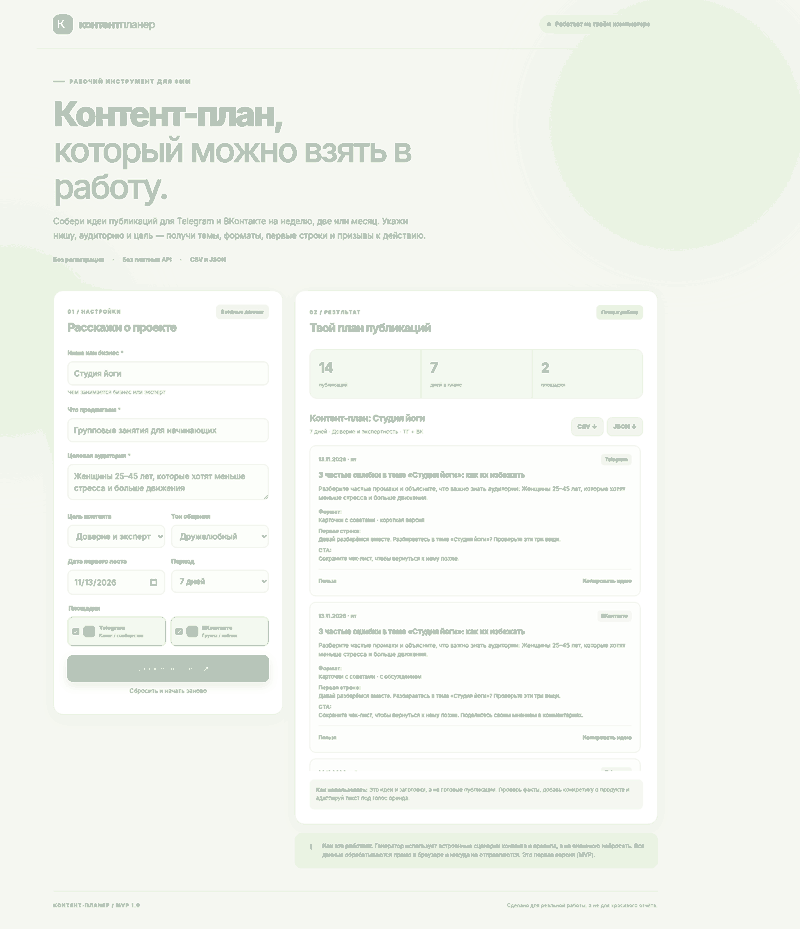

# Контент-планер — генератор контент-плана для Telegram и ВКонтакте

Локальный рабочий MVP для SMM-специалистов, предпринимателей и небольших команд. Помогает за несколько секунд составить план публикаций с темами, идеями, первыми строками, форматами и CTA.

## Задача

Планирование публикаций для нескольких площадок требует времени: нужно учесть тему бизнеса, целевую аудиторию, цель продвижения и особенности соцсетей. «Контент-планер» создаёт структурированный черновик, который можно доработать под реальные факты и тон бренда.

## Кому полезен

SMM-специалистам, маркетологам, владельцам малого бизнеса и авторам Telegram-каналов или сообществ ВКонтакте.

## Что умеет

- Учитывает нишу, продукт, целевую аудиторию, маркетинговую цель, тон общения.
- Создаёт план на 7, 14 или 30 дней для Telegram и/или ВКонтакте.
- Для каждой публикации предлагает тему, рубрику, идею, формат, первую строку и CTA.
- Позволяет скопировать отдельную идею.
- Сохраняет весь план в CSV (совместим с Excel) или JSON.
- Работает без регистрации, сервера, API-ключей и интернета.

## Как запустить

1. Скачайте архив проекта или клонируйте репозиторий.
2. Откройте `index.html` двойным щелчком в любом современном браузере.
3. Заполните форму слева и нажмите «Собрать контент-план».
4. Просмотрите предложения и скачайте CSV/JSON.

Никаких установок и команд не требуется. Файлы `index.html`, `styles.css` и `script.js` должны лежать в одной папке.

## Важное ограничение

**MVP не вызывает нейросеть.** Генерация происходит по локальным сценариям (правилам и шаблонам), поэтому тексты — это идеи и заготовки для редактора, а не автоматически проверенные факты и не готовые к публикации посты. Данные формы никуда не отправляются. Онлайн-публикации в соцсетях нет.

## Технологии

HTML5, CSS3, vanilla JavaScript; файлы JSON и CSV. Без сторонних библиотек.

## Структура проекта

```text
content-plan-studio/
├── index.html
├── styles.css
├── script.js
├── README.md
├── screenshots/
│   └── example.png
└── .claude/
    └── skills/
        └── content-plan-studio/
            └── SKILL.md
```

## Пользовательский сценарий

Ниша: студия йоги → продукт: занятия для начинающих → аудитория: женщины 25–45 → цель: доверие → площадки: Telegram и ВКонтакте → период: 7 дней. На выходе — 14 заготовок публикаций, которые можно скачать в CSV и JSON.

## Скриншот



## Следующая версия

Добавить подключение ИИ через локальную Ollama, редактор готовых постов, ручную правку строк плана, сохранение нескольких проектов и календарный режим. Это **планы**, в текущей версии этих функций нет.

## Скилл проекта

Инструкция для работы с проектом в Claude Code находится в `.claude/skills/content-plan-studio/SKILL.md`.